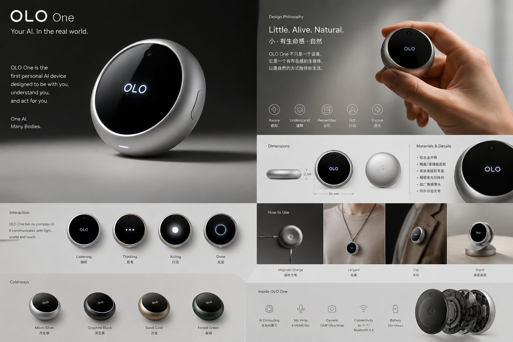

# OLO One generation 1 hardware specification

Status: industrial-design baseline; engineering feasibility pending  
Last updated: 2026-09-08

Parent baseline: [`OLO Product PRD v1.0`](product/OLO_Product_PRD_v1.0.md). Approved post-v1.0 details are recorded in [`product/DECISIONS.md`](product/DECISIONS.md).

## Source and authority

The product owner designated the image above as the **OLO One first-generation physical appearance proposal**. It is authoritative for intended form, visible materials, display philosophy, camera placement, interaction lighting, charging concept, and wearing modes.

Values printed on a concept board remain engineering targets until verified by mechanical, electrical, thermal, radio, optical, acoustic, battery, and manufacturing work. A render does not prove internal fit, runtime, signal performance, comfort, durability, or certification readiness.

## Design intent — Baseline

- Product: **OLO One**.
- Promise: **Your AI. In the real world.**
- Philosophy: **Little. Alive. Natural. / 小、有生命感、自然**.
- Identity model: **One AI. Many Bodies.**
- Intended character: a calm personal AI presence rather than a miniature phone or app launcher.

## External form — Baseline

| Attribute | Generation 1 direction |
| --- | --- |
| Overall shape | Compact rounded circular body with a soft pebble-like rear volume |
| Front | Black circular glass-like face inside a narrow metal rim |
| Diameter | 50 mm target |
| Thickness | 12.7 mm target shown in the design board |
| Primary control | Elongated tactile side button integrated into the metal body |
| Camera placement | One small camera centered near the upper edge of the front face |
| Status light | Short horizontal light bar near the lower front edge, plus graphics on the black face |
| Rear | Soft rounded contact surface with a central magnetic charging/accessory area |
| Bottom port | USB Type-C port for wired charging and service connectivity |

The 50 mm × 12.7 mm dimensions supersede the earlier approximate 50 mm × 12 mm concept where the two conflict.

## Screen philosophy — Baseline

OLO One has **no conventional general-purpose screen UI**. It must not present an app grid, keyboard, scrolling information architecture, or miniature phone interface.

The black front face is a restrained status and identity surface. It may render a small vocabulary of symbols and light states such as:

- `OLO` for presence/listening readiness;
- three dots for thinking;
- a central light point for acting;
- a ring for completion;
- minimal permission, error, battery, pairing, and power feedback when necessary.

This is described as a limited ambient display/light surface rather than “no pixels under any circumstances.” Its display technology, active area, resolution, brightness, and always-on behavior remain engineering decisions.

## Visible materials and construction — Baseline

- Aluminum-alloy middle frame and external structural rim.
- Dark curved front cover with a glass-like or ceramic-like appearance.
- Soft, skin-contact-friendly rounded rear surface.
- Precision tactile metal side button.
- Front camera aperture integrated into the black face.
- Ring/line-based optical status feedback integrated without exposing a conventional display border.

Exact glass, ceramic, polymer, coating, adhesive, gasket, surface-hardness, and ingress-protection specifications are open until engineering validation.

## Interaction language — Baseline

The appearance board confirms a minimal multimodal interface using light, sound, and touch rather than complex UI.

| State | Front treatment |
| --- | --- |
| Listening | OLO wordmark / quiet active identity |
| Thinking | Three small illuminated dots |
| Acting | Bright central light point |
| Done | Illuminated completion ring |

The full gesture and lifecycle contract remains defined by the master Product PRD and the iOS child PRD: tap listening, approximately 600 ms hold for Agent, double tap standby, flip privacy, and approximately 3 second side-button hold for power confirmation.

The industrial design must provide recognizable feedback for Quiet, Need You, Privacy, Offline, failure, and low battery in addition to the four states illustrated here.

## Camera and sensing — Target

- Camera: front, top-center, ultra-wide field of view.
- Design-board target: 12 MP ultra-wide camera.
- Microphones: six-MEMS microphone array.
- Local AI computing is shown as an internal capability.
- Orientation and flip-based privacy require an IMU even though the exploded-view labels do not show it explicitly.

Camera resolution, field of view, microphone placement, beamforming performance, local model capability, privacy indicator behavior, and sensor power budget require verification.

## Connectivity and battery — Target

- Design-board connectivity target: Wi-Fi 7 and Bluetooth 5.4.
- Design-board battery target: more than 20 hours.
- Charging: retain both the bottom USB Type-C port and the rear magnetic charging interface.
- USB Type-C provides wired charging and a physical service/maintenance connection.
- The rear magnetic interface provides convenient daily charging and alignment with compatible stands and accessories.

These are target claims, not validated specifications. Battery capacity, duty cycle, thermal envelope, charging power, charging time, antenna placement, coexistence, offline behavior, and cellular independence remain open.

## Carrying, wearing, and placement — Baseline

The same rear attachment/charging zone supports four first-generation usage modes:

1. **Handheld** — rounded perimeter and side-button access.
2. **Lanyard** — pendant-style carrying against clothing.
3. **Clip** — attachment to a lapel, pocket, or garment edge.
4. **Desktop stand** — an angled magnetic base that keeps the face visible.

Magnetic charging is also shown as a rear dock/puck connection. Accessories must prevent unintended rotation and detachment and must be evaluated for comfort, camera orientation, microphone occlusion, fabric interaction, and charging alignment. Accessory geometry must leave the bottom USB Type-C port usable where the intended mode requires simultaneous wired power or service access.

## Colorways — Baseline

- Moon Silver / 月岩银
- Graphite Black / 深空黑
- Sand Gold / 沙金
- Forest Green / 森绿

Moon Silver is the primary reference finish. Final alloy process, coating, gloss, color tolerance, scratch behavior, and accessory color matching remain CMF work.

## Relationship to the iOS app

- iOS must use the same Listening, Thinking, Acting, Done, Privacy, and error meanings.
- The app must not reproduce the front face as a dense simulated screen.
- Hardware state displayed in iOS must come from a real connection or be clearly labeled as simulated during development.
- Privacy state must stop microphone and camera capture on every connected body, with per-body verification.
- The app is responsible for detailed text, editing, permissions, authentication, task history, memory review, and explanations that do not fit the OLO One ambient surface.

## Engineering questions

1. Is the front surface OLED, micro-LED, segmented light guide, projection layer, or another low-power display architecture?
2. Which USB Type-C data modes, charging protocols, service functions, and waterproofing approach are required?
3. How do wired and magnetic charging arbitrate safely if both are connected?
4. Can a 50 mm × 12.7 mm enclosure fit the camera, six microphones, speaker, antennas, battery, compute, USB Type-C assembly, charging coil, thermal solution, and structural stack?
5. What weight target provides stable handheld use and comfortable lanyard/clip wear?
6. How does physical flip reliably assert privacy, and what hardware indicator remains trustworthy if software fails?
7. Does the camera remain correctly oriented in handheld, lanyard, clip, and stand modes?
8. What acoustic openings remain unobstructed across all accessories?
9. What conditions define the claimed 20+ hour runtime?
10. What radio capability is actually required for an iPhone-tethered first generation?
11. What ingress protection, drop resistance, operating temperature, skin-contact, magnetic-field, and regulatory targets apply?

## Prototype acceptance checks

- A dimensioned mechanical volume study validates the complete internal stack.
- An equal-weight model validates handheld, lanyard, and clip comfort.
- The side button is discoverable and operable in every carrying mode.
- Statuses remain distinguishable in indoor and outdoor lighting without becoming distracting.
- Microphone, speaker, camera, antennas, and charging perform with each accessory attached.
- Privacy state is physically recognizable and electronically verifiable.
- Thermal testing covers charging, local inference, camera use, and sustained wireless operation.
